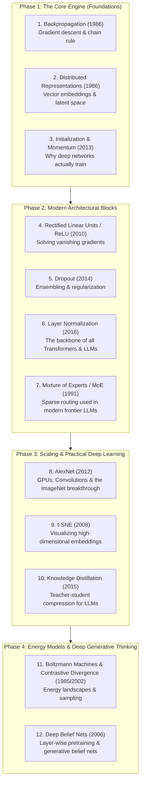

# Modern AI Foundations: Curated Paper Roadmap
> **A curated, high-yield study path through Geoffrey Hinton's landmark papers for mastering modern AI fundamentals (Transformers, LLMs, Optimization, and Architecture).**

---

## 🎯 Philosophy of this Roadmap

Out of the 30 papers in this repository, not all are equally relevant to modern AI engineering. Some are 1970s historical stepping stones, while others form the **direct architectural backbone of today's Transformers, Mixture of Experts (MoE), and Large Language Models (LLMs)**.

This roadmap filters the 30 papers down to the **12 highest-impact papers**, ordered in a sequence that maximizes clarity, minimizes mathematical roadblocks, and directly links 1980s–2010s breakthroughs to how state-of-the-art models work today.

---

## 🗺️ The 4-Phase Progression at a Glance



---

## 📚 Detailed Phase Breakdown

### Phase 1: The Core Engine (Optimization & Representation)
*Goal: Understand how neural networks adjust weights and represent knowledge in continuous vector spaces.*

| # | Paper & Year | Notebook in Repo | Modern Relevance | Difficulty | Key Focus in Notes |
|:---:|:---|:---|:---|:---:|:---|
| **1** | **Learning Representations by Back-Propagating Errors** (1986) | [Notebook](file:///e:/AI/Geoffrey-Hinton-Papers-Replicating-In-Pytorch/Learning_representations_by_back_propagating_errors.ipynb) | The foundation of all supervised learning and gradient descent in deep nets. | ⭐ (Easy) | Derivation of $\frac{\partial E}{\partial w_{ij}}$, error signals $\delta$, chain rule through hidden layers. |
| **2** | **Distributed Representations** (1986) | [Notebook](file:///e:/AI/Geoffrey-Hinton-Papers-Replicating-In-Pytorch/Distributed_Representations.ipynb) | The conceptual birth of **vector embeddings** (word2vec, transformer token embeddings, latent spaces). | ⭐ (Easy) | Localist vs. distributed representations, semantic similarity as geometric proximity. |
| **3** | **On the Importance of Initialization and Momentum in Deep Learning** (2013) | [Notebook](file:///e:/AI/Geoffrey-Hinton-Papers-Replicating-In-Pytorch/On_the_importance_of_initialization_and_momentum_in_deep_learning.ipynb) | Why deep networks failed to train for decades and how proper initialization + Nesterov momentum unlocked deep architectures. | ⭐⭐ (Moderate) | Vanishing/exploding signals, curvature, Hessian conditioning, Nesterov accelerated gradient. |

---

### Phase 2: Modern Architectural Blocks
*Goal: Master the standard components inside modern architectures (Transformers, ResNets, MoE).*

| # | Paper & Year | Notebook in Repo | Modern Relevance | Difficulty | Key Focus in Notes |
|:---:|:---|:---|:---|:---:|:---|
| **4** | **Rectified Linear Units Improve Restricted Boltzmann Machines** (2010) | [Notebook](file:///e:/AI/Geoffrey-Hinton-Papers-Replicating-In-Pytorch/Rectified_Linear_Units_Improve_Restricted_Boltzmann_Machines.ipynb) | Why sigmoid/tanh were replaced by **ReLU/GELU/SwiGLU**; non-saturating gradients. | ⭐ (Easy) | Sparsity, gradient propagation without saturation, dead neurons. |
| **5** | **Dropout: A Simple Way to Prevent Neural Networks from Overfitting** (2014) | [Notebook](file:///e:/AI/Geoffrey-Hinton-Papers-Replicating-In-Pytorch/Dropout_A_Simple_Way_to_Prevent_Neural_Networks_from_overfitting.ipynb) | Essential regularization; implicit ensembling of $2^N$ sub-networks. | ⭐⭐ (Moderate) | Inverted dropout formula, scaling at test time, co-adaptation of features. |
| **6** | **Layer Normalization** (2016) | [Notebook](file:///e:/AI/Geoffrey-Hinton-Papers-Replicating-In-Pytorch/Layer_Normalization.ipynb) | **Directly used in every Transformer (GPT, Llama, Gemini, BERT)** instead of BatchNorm. | ⭐⭐ (Moderate) | Batch dimension independence, invariance to shift/scale, stabilizing hidden state dynamics. |
| **7** | **Adaptive Mixtures of Local Experts (MoE)** (1991) | [Notebook](file:///e:/AI/Geoffrey-Hinton-Papers-Replicating-In-Pytorch/Adaptive_Mixtures_of_Local_Experts.ipynb) | The exact architecture behind **sparse frontier LLMs** (Mixtral, GPT-4, modern MoEs). | ⭐⭐⭐ (Moderate) | Gating network, competitive soft routing, division of labor among experts. |

---

### Phase 3: Scaling & Practical Deep Learning
*Goal: Understand the transition to massive scale, high-dimensional visualization, and model compression.*

| # | Paper & Year | Notebook in Repo | Modern Relevance | Difficulty | Key Focus in Notes |
|:---:|:---|:---|:---|:---:|:---|
| **8** | **ImageNet Classification with Deep CNNs (AlexNet)** (2012) | [Notebook](file:///e:/AI/Geoffrey-Hinton-Papers-Replicating-In-Pytorch/ImageNet_Classification_with_Deep_Convolutional_Neural_Networks_AlexNet.ipynb) | The "Big Bang" of modern AI. GPUs + Convolutions + Data Augmentation. | ⭐⭐ (Moderate) | Conv layer design, GPU memory splitting, data augmentation pipeline. |
| **9** | **Visualizing Data using t-SNE** (2008) | [Notebook](file:///e:/AI/Geoffrey-Hinton-Papers-Replicating-In-Pytorch/Visualizing_Data_using_t_SNE.ipynb) | The gold standard for visualizing embeddings and feature spaces in 2D/3D. | ⭐⭐⭐ (Moderate) | Student-t distribution heavy tails, crowding problem, KL divergence optimization. |
| **10** | **Distilling the Knowledge in a Neural Network** (2015) | [Notebook](file:///e:/AI/Geoffrey-Hinton-Papers-Replicating-In-Pytorch/Distilling_the_Knowledge_in_a_Neural_Network.ipynb) | The technique used to distill frontier models into efficient edge models (e.g. 70B $\to$ 8B LLMs). | ⭐⭐ (Moderate) | Soft targets, temperature parameter $T$, dark knowledge transfer. |

---

### Phase 4: Energy Models & Generative Thinking
*Goal: Master probability distributions, energy landscapes, and deep probabilistic models.*

| # | Paper & Year | Notebook in Repo | Modern Relevance | Difficulty | Key Focus in Notes |
|:---:|:---|:---|:---|:---:|:---|
| **11** | **A Learning Algorithm for Boltzmann Machines** (1985) & **Contrastive Divergence** (2002) | [Boltzmann Notebook](file:///e:/AI/Geoffrey-Hinton-Papers-Replicating-In-Pytorch/A_Learning_Algorithm_for_Boltzmann_Machines.ipynb) & [CD Notebook](file:///e:/AI/Geoffrey-Hinton-Papers-Replicating-In-Pytorch/Training_Products_of_Experts_by_Minimizing_Contrastive_Divergence.ipynb) | Deep connection between statistical physics, energy functions, MCMC, and modern diffusion models. | ⭐⭐⭐⭐ (Challenging) | Energy function $E(v,h)$, partition function $Z$, positive vs negative phase, CD-1. |
| **12** | **A Fast Learning Algorithm for Deep Belief Nets** (2006) | [Notebook](file:///e:/AI/Geoffrey-Hinton-Papers-Replicating-In-Pytorch/A_fast_learning_algorithm_for_deep_belief_nets.ipynb) & [fastnc.pdf](file:///e:/AI/Geoffrey-Hinton-Papers-Replicating-In-Pytorch/Papers/fastnc.pdf) | The paper that proved deep unsupervised learning is possible. | ⭐⭐⭐⭐⭐ (Advanced) | Explaining away, complementary priors, layer-wise pre-training, variational lower bound. |

---

## 📝 Note-Taking Strategy for Each Paper

For each paper you read, create a folder under `notes/`:
```text
notes/
└── <paper_number>_<paper_slug>/
    ├── 01_concept_and_intuition.md   # The "Why" and physical/mathematical intuition
    ├── 02_math_and_derivations.md    # Every equation written out and explained
    └── 03_pytorch_implementation.md  # Code mapping from the notebook
```

### 3 Questions Every Note Must Answer:
1. **What bottleneck was the author trying to solve?** (Why did previous methods fail?)
2. **What was the core mathematical or architectural trick?**
3. **Where does this concept live in modern AI today?** (e.g., *LayerNorm $\to$ used in Llama/GPT*).

---

## 🚀 Recommended Next Step
Start with **Paper 1: Learning Representations by Back-Propagating Errors (1986)**.
It takes ~1 hour, connects directly to your calculus knowledge, and gives you your first completed note!
