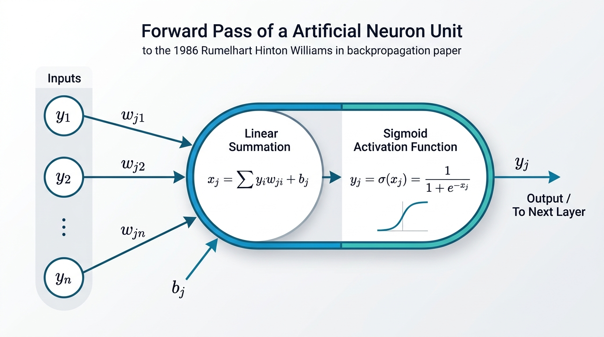
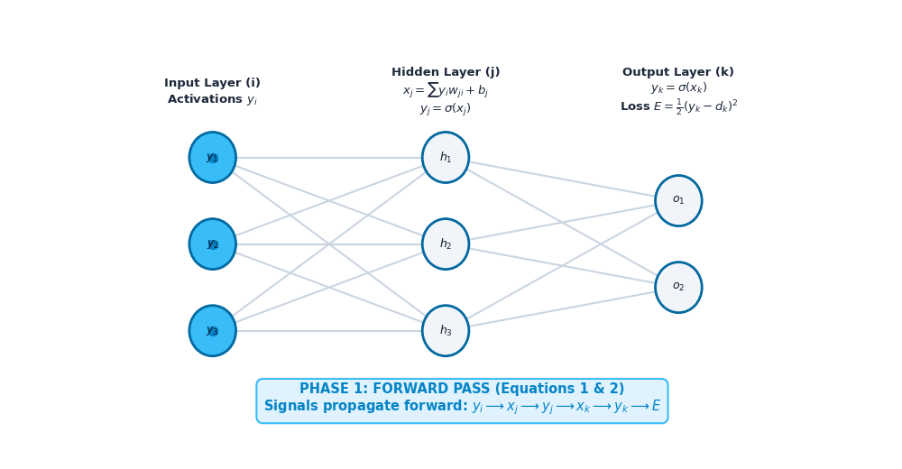
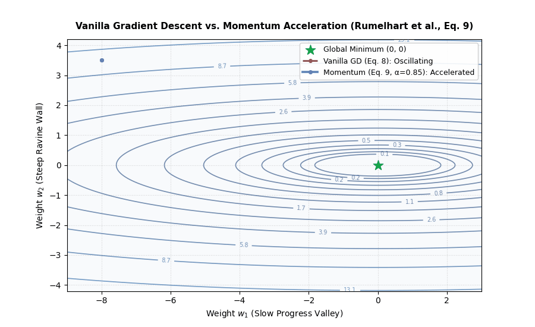
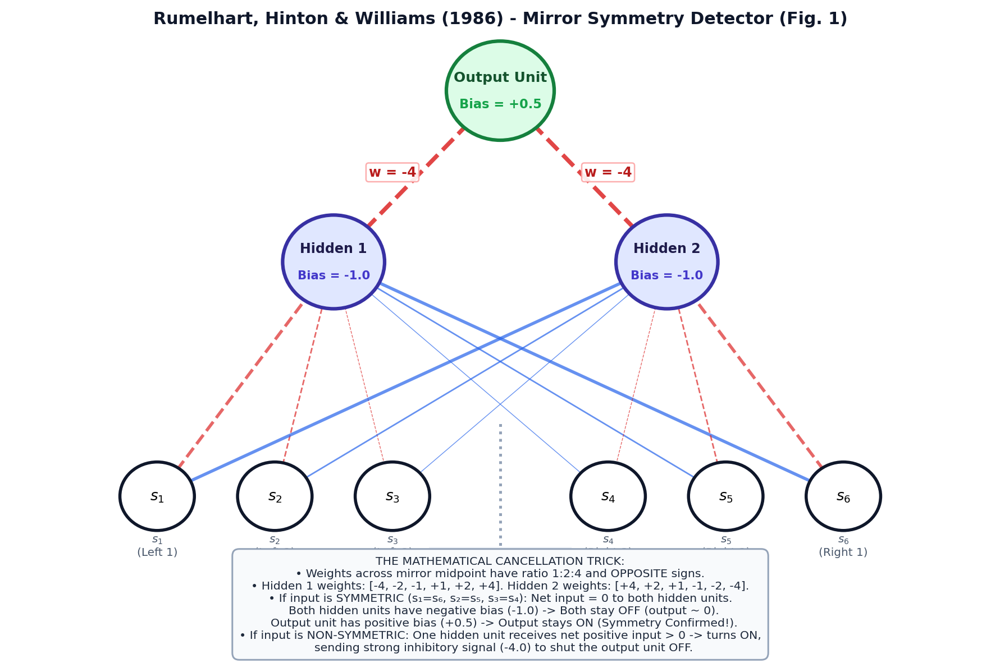
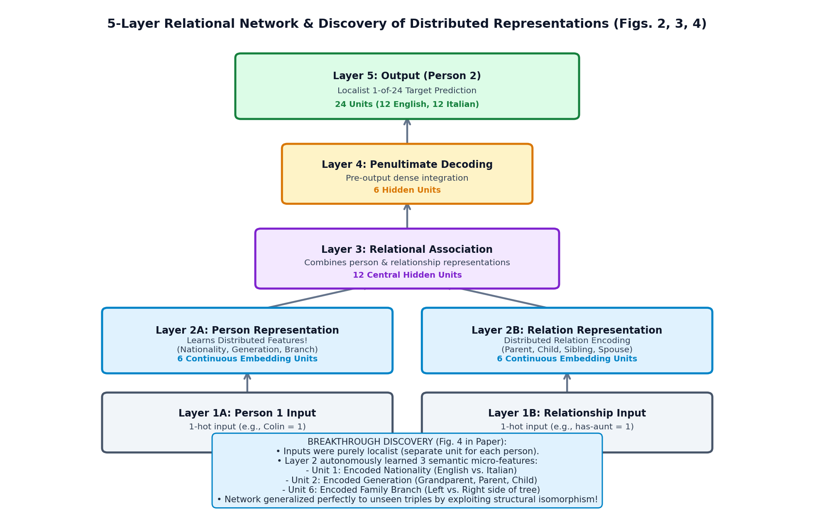
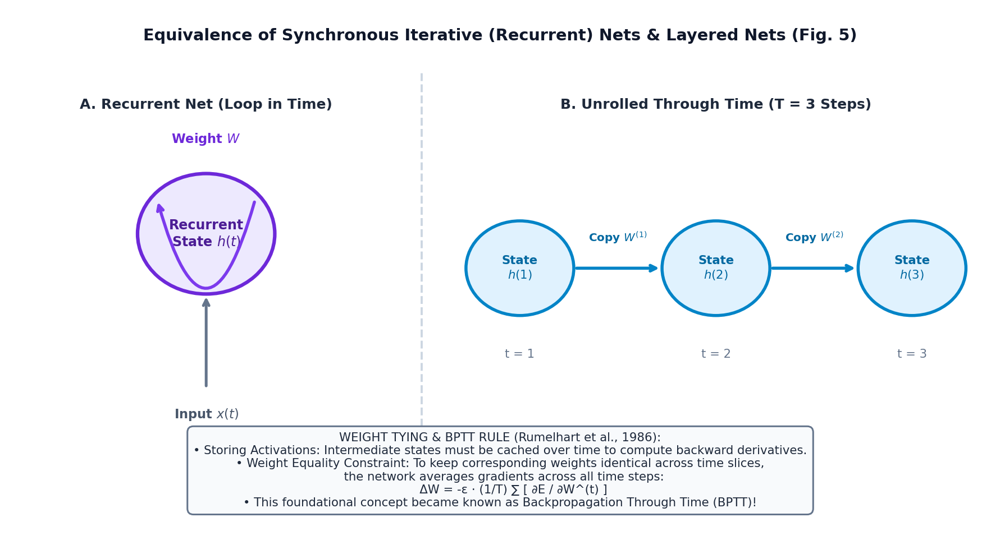

# Line-by-Line Study Guide & Notes: "Learning Representations by Back-Propagating Errors" (1986)

**Paper:** _Learning representations by back-propagating errors_  
**Authors:** David E. Rumelhart, Geoffrey E. Hinton, Ronald J. Williams  
**Publication:** _Nature_, Vol. 323, 9 October 1986, pp. 533–536  
**Repository Document:** [01_1986_Backpropagation.pdf](file:///e:/AI/Geoffrey-Hinton-Papers-Replicating-In-Pytorch/Papers/01_1986_Backpropagation.pdf)  
**Accompanying Code Notebook:** [Learning_representations_by_back_propagating_errors.ipynb](file:///e:/AI/Geoffrey-Hinton-Papers-Replicating-In-Pytorch/Learning_representations_by_back_propagating_errors.ipynb)

---

## Executive Summary & Historical Background

In 1969, Marvin Minsky and Seymour Papert published their influential book _Perceptrons_, which mathematically proved that single-layer perceptrons could not compute non-linearly separable functions, such as the simple **XOR** (exclusive OR) or **parity/symmetry** problems. While multi-layer networks could theoretically compute such functions, researchers lacked a general, efficient algorithm to train the hidden layers. When an entire network made an error, no one knew how to distribute blame to internal neurons whose targets were not explicitly provided by the training data. This was known as the **credit-assignment problem**, and it triggered the first "AI Winter."

Rumelhart, Hinton, and Williams solved this crisis by formulating **back-propagation**: an application of the multivariate chain rule of calculus that propagates error gradients backward from the output layer to intermediate layers. Crucially, they showed that hidden units autonomously discover **internal representations**—abstract, distributed features of the domain—without human hand-engineering.

---

## Part 1: Abstract & The Credit Assignment Problem

### Original Text (Lines 129–140)

> _"We describe a new learning procedure, back-propagation, for networks of neurone-like units. The procedure repeatedly adjusts the weights of the connections in the network so as to minimize a measure of the difference between the actual output vector of the net and the desired output vector. As a result of the weight adjustments, internal 'hidden' units which are not part of the input or output come to represent important features of the task domain, and the regularities in the task are captured by the interactions of these units. The ability to create useful new features distinguishes back-propagation from earlier, simpler methods such as the perceptron-convergence procedure."_

#### Detailed Explanation & Line-by-Line Breakdown:

1. **"We describe a new learning procedure, back-propagation, for networks of neurone-like units."**
   - _Meaning:_ The authors propose an algorithmic method to adjust the connection strengths (weights) in multi-layer connectionist networks.
   - _Context:_ The term "neurone-like units" denotes idealized mathematical abstractions of biological neurons (receiving inputs, summing them, and firing through an activation function).
2. **"The procedure repeatedly adjusts the weights... to minimize a measure of the difference between the actual output vector... and the desired output vector."**
   - _Meaning:_ Learning is cast as continuous numerical optimization. An error (loss) function quantifies the discrepancy between what the network predicts ($\mathbf{y}$) and what is desired ($\mathbf{d}$). Gradient descent shifts weights iteratively down the error slope.
3. **"internal 'hidden' units which are not part of the input or output come to represent important features of the task domain..."**
   - _Meaning:_ This is the core conceptual thesis. Prior systems required engineers to manually define input features. Under backpropagation, intermediate layers self-organize to encode semantic representations (e.g., family relationships, symmetry lines, edges, concepts).
4. **"The ability to create useful new features distinguishes back-propagation from earlier, simpler methods such as the perceptron-convergence procedure."**
   - _Meaning:_ Rosenblatt's Perceptron Convergence Theorem (1962) guaranteed convergence _only_ for single-layer networks on linearly separable data. Backpropagation breaks this restriction by discovering internal features on its own.

---

### Original Text (Lines 141–166)

> _"There have been many attempts to design self-organizing neural networks. The aim is to find a powerful synaptic modification rule that will allow an arbitrarily connected neural network to develop an internal structure that is appropriate for a particular task domain. The task is specified by giving the desired state vector of the output units for each state vector of the input units. If the input units are directly connected to the output units it is relatively easy to find learning rules that iteratively adjust the relative strengths of the connections so as to progressively reduce the difference between the actual and desired output vectors. Learning becomes more interesting but more difficult when we introduce hidden units whose actual or desired states are not specified by the task. (In perceptrons, there are 'feature analysers' between the input and output that are not true hidden units because their input connections are fixed by hand, so their states are completely determined by the input vector: they do not learn representations.) The learning procedure must decide under what circumstances the hidden units should be active in order to help achieve the desired input-output behaviour. This amounts to deciding what these units should represent. We demonstrate that a general purpose and relatively simple procedure is powerful enough to construct appropriate internal representations."_

#### Key Concepts & Analysis:

- **The "Credit Assignment Problem":** If the output is wrong, how much of the fault belongs to neuron $A$ in layer 1 versus neuron $B$ in layer 2?
- **Perceptron "Feature Analysers" vs. True Hidden Units:**
  - In Rosenblatt's Perceptron, intermediate units had fixed, random, or hardcoded weights. Only the final output weights were learnable.
  - In true multi-layer networks, intermediate representations are learnable. The network autonomously decides what features are useful for the task.

---

## Part 2: Architecture & Forward Propagation

### Original Text (Lines 168–198)

> _"The simplest form of the learning procedure is for layered networks which have a layer of input units at the bottom; any number of intermediate layers; and a layer of output units at the top. Connections within a layer or from higher to lower layers are forbidden, but connections can skip intermediate layers. An input vector is presented to the network by setting the states of the input units. Then the states of the units in each layer are determined by applying equations (1) and (2) to the connections coming from lower layers. All units within a layer have their states set in parallel, but different layers have their states set sequentially, starting at the bottom and working upwards until the states of the output units are determined._
>
> _The total input, $x_j$, to unit $j$ is a linear function of the outputs, $y_i$, of the units that are connected to $j$ and of the weights, $w_{ji}$, on these connections:_
> $$x_j = \sum_i y_i w_{ji} \quad (1)$$
>
> _Units can be given biases by introducing an extra input to each unit which always has a value of 1. The weight on this extra input is called the bias and is equivalent to a threshold of the opposite sign. It can be treated just like the other weights._
>
> _A unit has a real-valued output, $y_j$, which is a non-linear function of its total input:_
>
> $$
> y_j = \frac{1}{1 + e^{-x_j}} \quad (2)
> $$

#### Detailed Mathematical Breakdown:

#### 1. Input Accumulation (Equation 1):

$$x_j = \sum_i y_i w_{ji}$$

- $x_j$ is the total net pre-activation input to unit $j$.
- $y_i$ is the activation output of unit $i$ from the preceding layer.
- $w_{ji}$ is the connection weight from sending unit $i$ to receiving unit $j$.
- **Bias Formulation:** A bias $b_j$ shifts the activation threshold. The authors implement this seamlessly:
  $$x_j = \sum_{i=1}^n y_i w_{ji} + b_j = \sum_{i=0}^n y_i w_{ji} \quad \text{where } y_0 = 1, w_{j0} = b_j$$

#### 2. The Logistic Sigmoid Activation (Equation 2):

$$y_j = \sigma(x_j) = \frac{1}{1 + e^{-x_j}}$$

- **Why Sigmoid over Step Functions?**
  - Rosenblatt's perceptron used a Heaviside step function:
    $$f(x) = \begin{cases} 1 & x \ge 0 \\ 0 & x < 0 \end{cases}$$
    Its derivative is zero everywhere (and undefined at $0$). Gradient descent requires non-zero derivatives to know which direction to update weights.
  - The sigmoid function $\sigma(x)$ is continuous, strictly monotonic, bounded between $(0, 1)$, and smooth everywhere.
- **Mathematical Derivation of the Sigmoid Derivative:**
  Let $y = \frac{1}{1 + e^{-x}} = (1 + e^{-x})^{-1}$.
  $$\frac{dy}{dx} = -1(1 + e^{-x})^{-2} \cdot (-e^{-x}) = \frac{e^{-x}}{(1 + e^{-x})^2}$$
  Notice that:
  $$\frac{e^{-x}}{(1 + e^{-x})^2} = \left(\frac{1}{1 + e^{-x}}\right) \left(\frac{e^{-x}}{1 + e^{-x}}\right) = \left(\frac{1}{1 + e^{-x}}\right) \left(1 - \frac{1}{1 + e^{-x}}\right) = y(1 - y)$$
  $$\therefore \frac{dy}{dx} = y(1 - y)$$
  _This simple form makes the backward pass computationally efficient: computing the derivative requires no exponentials, only multiplying the existing output $y$ by $(1 - y)$!_

---

## Part 3: The Loss Function & Backward Pass Derivation

### Original Text (Lines 237–257, 301–324, 393–407)

> _"The aim is to find a set of weights that ensure that for each input vector the output vector produced by the network is the same as (or sufficiently close to) the desired output vector... The total error, $E$, is defined as:_
> $$E = \frac{1}{2} \sum_c \sum_j (y_{j,c} - d_{j,c})^2 \quad (3)$$
> _where $c$ is an index over cases (input-output pairs), $j$ is an index over output units, $y$ is the actual state of an output unit and $d$ is its desired state._
>
> _To minimize $E$ by gradient descent it is necessary to compute the partial derivative of $E$ with respect to each weight in the network. This is simply the sum of the partial derivatives for each of the input-output cases..._
>
> _The backward pass starts by computing $\partial E / \partial y$ for each of the output units. Differentiating equation (3) for a particular case, $c$, and suppressing the index $c$ gives:_
> $$\frac{\partial E}{\partial y_j} = y_j - d_j \quad (4)$$
>
> _We can then apply the chain rule to compute $\partial E / \partial x_j$:_
> $$\frac{\partial E}{\partial x_j} = \frac{\partial E}{\partial y_j} \frac{dy_j}{dx_j}$$
> _Differentiating equation (2) to get the value of $dy_j/dx_j$ and substituting gives:_
> $$\frac{\partial E}{\partial x_j} = \frac{\partial E}{\partial y_j} \cdot y_j (1 - y_j) \quad (5)$$
>
> _For a weight $w_{ji}$ from $i$ to $j$ the derivative is:_
> $$\frac{\partial E}{\partial w_{ji}} = \frac{\partial E}{\partial x_j} \frac{\partial x_j}{\partial w_{ji}} = \frac{\partial E}{\partial x_j} \cdot y_i \quad (6)$$
>
> _and for the output of the $i^{\text{th}}$ unit the contribution to $\partial E / \partial y_i$ resulting from the effect of $i$ on $j$ is simply:_
> $$\frac{\partial E}{\partial x_j} \frac{\partial x_j}{\partial y_i} = \frac{\partial E}{\partial x_j} \cdot w_{ji}$$
> _so taking into account all the connections emanating from unit $i$ we have:_
>
> $$
> \frac{\partial E}{\partial y_i} = \sum_j \frac{\partial E}{\partial x_j} \cdot w_{ji} \quad (7)
> $$

---

### Step-by-Step Mathematical Derivation

Let us derive Equations (4) through (7) with full algebraic precision.

#### Step 1: Derivative of Loss with Respect to Output (Equation 4)

For a single training example, the error is:
$$E = \frac{1}{2} \sum_k (y_k - d_k)^2$$
Differentiating with respect to the output $y_j$ of output unit $j$:
$$\frac{\partial E}{\partial y_j} = \frac{\partial}{\partial y_j} \left[ \frac{1}{2} (y_j - d_j)^2 \right] = \frac{1}{2} \cdot 2(y_j - d_j) \cdot 1 = y_j - d_j \quad \text{--- Eq. (4)}$$
_(Note: The factor of $\frac{1}{2}$ cancels out cleanly with the power of 2.)_

#### Step 2: Error Signal with Respect to Pre-Activation Input (Equation 5)

By the chain rule:
$$\frac{\partial E}{\partial x_j} = \frac{\partial E}{\partial y_j} \cdot \frac{\partial y_j}{\partial x_j}$$
Using our earlier sigmoid derivative $\frac{\partial y_j}{\partial x_j} = y_j(1 - y_j)$:
$$\frac{\partial E}{\partial x_j} = \frac{\partial E}{\partial y_j} \cdot y_j(1 - y_j) \quad \text{--- Eq. (5)}$$
In modern deep learning literature, this quantity is often denoted by $\delta_j \equiv \frac{\partial E}{\partial x_j}$.

#### Step 3: Gradient with Respect to Connection Weights (Equation 6)

To find how the weight $w_{ji}$ (from unit $i$ to unit $j$) impacts the error:
$$\frac{\partial E}{\partial w_{ji}} = \frac{\partial E}{\partial x_j} \cdot \frac{\partial x_j}{\partial w_{ji}}$$
Since $x_j = \sum_k y_k w_{jk} = y_i w_{ji} + \sum_{k \neq i} y_k w_{jk}$, the partial derivative is simply:
$$\frac{\partial x_j}{\partial w_{ji}} = y_i$$
Therefore:
$$\frac{\partial E}{\partial w_{ji}} = \frac{\partial E}{\partial x_j} \cdot y_i = \delta_j \cdot y_i \quad \text{--- Eq. (6)}$$
**Intuitive interpretation:** The gradient of a weight is simply the **error signal of the receiving unit ($\delta_j$)** multiplied by the **activation of the sending unit ($y_i$)**. This is a purely local computation!

#### Step 4: Propagating Error to Preceding Layers (Equation 7)

Now consider an earlier unit $i$ whose output $y_i$ feeds into multiple receiving units $j$ in the layer above. How does changing $y_i$ affect total error $E$?
By the multivariate chain rule:
$$\frac{\partial E}{\partial y_i} = \sum_j \left( \frac{\partial E}{\partial x_j} \cdot \frac{\partial x_j}{\partial y_i} \right)$$
Since $x_j = \sum_k y_k w_{jk}$, the partial derivative $\frac{\partial x_j}{\partial y_i} = w_{ji}$. Substituting:
$$\frac{\partial E}{\partial y_i} = \sum_j \frac{\partial E}{\partial x_j} \cdot w_{ji} = \sum_j \delta_j \cdot w_{ji} \quad \text{--- Eq. (7)}$$
Once we have $\frac{\partial E}{\partial y_i}$, we can immediately compute unit $i$'s input error signal via Equation (5):
$$\frac{\partial E}{\partial x_i} = \frac{\partial E}{\partial y_i} \cdot y_i(1 - y_i)$$
And then compute gradients for weights entering unit $i$ via Equation (6):
$$\frac{\partial E}{\partial w_{ik}} = \frac{\partial E}{\partial x_i} \cdot y_k$$
**This recursive formula can be repeated backward through an arbitrary number of hidden layers!**

---

## Part 4: Weight Updates, Momentum & Regularization

### Original Text (Lines 408–434)

> _"One way of using $\partial E / \partial w$ is to change the weights after every input-output case. This has the advantage that no separate memory is required for the derivatives. An alternative scheme, which we used in the research reported here, is to accumulate $\partial E / \partial w$ over all the input-output cases before changing the weights. The simplest version of gradient descent is to change each weight by an amount proportional to the accumulated $\partial E / \partial w$:_
> $$\Delta w = -\varepsilon \frac{\partial E}{\partial w} \quad (8)$$
>
> _This method does not converge as rapidly as methods which make use of the second derivatives, but it is much simpler and can easily be implemented by local computations in parallel hardware. It can be significantly improved, without sacrificing the simplicity and locality, by using an acceleration method in which the current gradient is used to modify the velocity of the point in weight space instead of its position:_
> $$\Delta w(t) = -\varepsilon \frac{\partial E}{\partial w}(t) + \alpha \Delta w(t - 1) \quad (9)$$
> _where $t$ is incremented by 1 for each sweep through the whole set of input-output cases, and $\alpha$ is an exponential decay factor between 0 and 1 that determines the relative contribution of the current gradient and earlier gradients to the weight change._
>
> _To break symmetry we start with small random weights."_

#### Detailed Analysis:

1. **Online (Stochastic) vs. Batch Learning:**
   - _Online (Stochastic):_ Update weights after every single sample ($c$). Memory-efficient, introduces noise that can jump out of shallow local minima.
   - _Batch (Accumulated):_ Sum gradients over all $N$ training examples before taking a step. Smoother, accurate gradient of the true error surface. The 1986 paper uses full batch updates across "sweeps" (epochs).

2. **Standard Gradient Descent (Equation 8):**
   $$\Delta w = -\varepsilon \frac{\partial E}{\partial w}$$
   - $\varepsilon$ is the **learning rate**.
   - If $\varepsilon$ is too large, the optimizer overshoots ravines and diverges. If too small, training is excruciatingly slow.

3. **Momentum Acceleration (Equation 9):**
   $$\Delta w(t) = -\varepsilon \frac{\partial E}{\partial w}(t) + \alpha \Delta w(t-1)$$
   - Physical analogy: A heavy ball rolling down an error landscape with friction.
   - If consecutive gradients point in the same direction, $\Delta w$ accumulates, accelerating descent down shallow plateaus:
     $$\Delta w \approx -\frac{\varepsilon}{1 - \alpha} \frac{\partial E}{\partial w}$$
     For $\alpha = 0.9$, the effective step size is multiplied by 10!
   - In narrow, oscillating ravines where gradients bounce back and forth, the alternating components cancel out, damping oscillations and stabilizing progress.

4. **Symmetry Breaking:**
   - If all weights start at identical values (e.g., zero), every hidden unit in a layer receives identical inputs, computes identical outputs, and receives identical gradient signals:
     $$\delta_j = \delta_k \implies \Delta w_{ji} = \Delta w_{ki}$$
   - The units would remain clones forever. Initializing weights with small random values breaks this symmetry, allowing units to specialize into different feature detectors.

5. **Weight Decay & Output Tolerances (Lines 357–365):**
   - **Weight Decay:** Every weight is decremented by a fraction (e.g., $0.2\%$) after each update. Equivalent to $L_2$ regularization:
     $$w \leftarrow w(1 - \lambda)$$
     This prevents weights from exploding, forces unused connections towards zero, and leaves only functionally essential weights large and interpretable.
   - **Output Tolerance Margins:** If the target is $1$, an output $> 0.8$ is treated as having zero error. If the target is $0$, an output $< 0.2$ is treated as zero error.
     - _Why?_ Because the sigmoid $\sigma(x) = \frac{1}{1 + e^{-x}}$ reaches $1.0$ only at $x = +\infty$ and $0.0$ only at $x = -\infty$. Demanding exact $1.0$ or $0.0$ targets forces weights to grow infinitely large, causing gradient saturation.

---

## Part 5: Experiment 1 – Mirror Symmetry Detection

### Original Text (Lines 207–230, 439–451)

> _"One simple task that cannot be done by just connecting the input units to the output units is the detection of symmetry. To detect whether the binary activity levels of a one-dimensional array of input units are symmetrical about the centre point, it is essential to use an intermediate layer because the activity in an individual input unit, considered alone, provides no evidence about the symmetry or non-symmetry of the whole input vector... The learning procedure discovered an elegant solution using just two intermediate units, as shown in Fig. 1."_

#### The Mathematical Ingenuity of the Learned Solution:

1. **The Setup:** A 6-bit binary input string $(s_1, s_2, s_3, s_4, s_5, s_6) \in \{0, 1\}^6$. There are $2^6 = 64$ possible vectors. Only 8 are symmetric (e.g., `101101`, `010010`).
2. **Why Perceptrons Cannot Solve This:**
   - Symmetry depends on pairwise relationships: $s_1 = s_6$, $s_2 = s_5$, $s_3 = s_4$.
   - A single-layer perceptron computes $\sum_i w_i s_i$. Knowing $s_1 = 1$ provides zero evidence about whether the full vector is symmetric unless you compare it to $s_6$.
3. **The Discovered Weight Pattern:**
   - Notice the weight ratio on one side of the midpoint: **$1 : 2 : 4$**!
     $$\text{Weights for } s_1, s_2, s_3 = (-4, -2, -1)$$
     $$\text{Weights for } s_4, s_5, s_6 = (+1, +2, +4)$$
   - This ratio corresponds to powers of 2 (binary place value!).
   - Every 3-bit combination $(s_1, s_2, s_3)$ produces a **unique integer sum** between $-7$ and $0$.
   - The right side $(s_4, s_5, s_6)$ produces a unique integer sum between $0$ and $+7$.
   - **The Sum Cancels to Exactly Zero IF AND ONLY IF the pattern is symmetric!**
     $$(-4s_1 - 2s_2 - 1s_3) + (1s_4 + 2s_5 + 4s_6) = 0 \iff (s_1, s_2, s_3) = (s_6, s_5, s_4)$$
4. **The Gate Mechanism:**
   - Both hidden units have negative bias ($-1$). When net input is $0$, hidden units remain below threshold and stay **OFF** (output $\approx 0$).
   - If non-symmetric, one hidden unit receives positive input and turns **ON**.
   - When a hidden unit turns on, it strongly inhibits the output unit (via weight $-4$).
   - The output unit has positive bias ($+0.5$), so it stays **ON** (symmetry detected) unless suppressed by a hidden unit!

---

## Part 6: Experiment 2 – Learning Family Trees & Distributed Representations

### Original Text (Lines 273–300, 337–365, 452–456)

> _"Fig. 2 Two isomorphic family trees. The information can be expressed as a set of triples of the form (person 1)(relationship)(person 2)..._
> _Fig. 3 Activity levels in a five-layer network after it has learned. The bottom layer has 24 input units on the left for representing (person 1) and 12 input units on the right for representing the relationship... Each of the two input groups is totally connected to its own group of 6 units in the second layer. These groups learn to encode people and relationships as distributed patterns of activity. The second layer is totally connected to the central layer of 12 units, and these are connected to the penultimate layer of 6 units..._
> _Fig. 4 The weights from the 24 input units... to the 6 units in the second layer... Unit 1 is primarily concerned with the distinction between English and Italian... Unit 2 encodes which generation a person belongs to, and unit 6 encodes which branch of the family they come from... Because the hidden features capture the underlying structure of the task domain, the network generalizes correctly to the four triples on which it was not trained."_

#### Crucial Insights:

1. **The Invention of Learned Embeddings:**
   - The input used localist (one-hot) encodings: single unit active for "Colin", single unit active for "has-aunt".
   - Layer 2 compressed these 24 people into 6 continuous hidden units.
   - **What did these 6 units learn?**
     - **Unit 1:** Encoded Nationality (English vs. Italian).
     - **Unit 2:** Encoded Generation (Grandparent = $-$, Parent = $0$, Child = $+$).
     - **Unit 6:** Encoded Family Branch (Left branch vs. Right branch).
   - This was the earliest demonstration of **learned continuous representations (embeddings)**—the foundational concept behind Word2Vec, BERT, and modern LLM token embeddings!
2. **Generalization via Isomorphism:**
   - The network was trained on 100 triples and held out 4 triples.
   - Because the representations mapped equivalent roles in the English and Italian trees into similar internal coordinates, the network correctly answered queries about unseen triples.

---

## Part 7: Equivalence of Layered & Recurrent Networks (BPTT)

### Original Text (Lines 371–388, 457–460)

> _"Fig. 5 A synchronous iterative net that is run for three iterations and the equivalent layered net. Each time-step in the recurrent net corresponds to a layer in the layered net. The learning procedure for layered nets can be mapped into a learning procedure for iterative nets. Two complications arise in performing this mapping: first, in a layered net the output levels of the units in the intermediate layers during the forward pass are required for performing the backward pass... So in an iterative net it is necessary to store the history of output states of each unit. Second, for a layered net to be equivalent to an iterative net, corresponding weights between different layers must have the same value. To preserve this property, we average $\partial E / \partial w$ for all the weights in each set of corresponding weights and then change each weight in the set by an amount proportional to this average gradient."_

#### Backpropagation Through Time (BPTT) Formulation:

1. **Unrolling through Time:**
   - A recurrent network with feedback connections running for $T$ discrete time steps is mathematically identical to a feed-forward network with $T$ distinct layers.
2. **Weight Tying & Constraint Optimization:**
   - In a physical recurrent network, there is only one set of connection weights $W$, reused at every time step $t \in \{1, 2, \dots, T\}$.
   - In the unrolled feed-forward network, each time-slice has a copy $W^{(t)}$.
   - To keep weights synchronized, the gradient for the shared parameter $w$ is the sum (or average) of gradients across all time steps:
     $$\frac{\partial E}{\partial w} = \sum_{t=1}^T \frac{\partial E}{\partial w^{(t)}}$$
3. **Historical Significance:** This single paragraph laid the conceptual and mathematical foundation for **Recurrent Neural Networks (RNNs)** and **LSTMs**.

---

## Part 8: Local Minima, Biological Plausibility & Legacy

### Original Text (Lines 461–484)

> _"The most obvious drawback of the learning procedure is that the error-surface may contain local minima so that gradient descent is not guaranteed to find a global minimum. However, experience with many tasks shows that the network very rarely gets stuck in poor local minima that are significantly worse than the global minimum. We have only encountered this undesirable behaviour in networks that have just enough connections to perform the task. Adding a few more connections creates extra dimensions in weight-space and these dimensions provide paths around the barriers that create poor local minima in the lower dimensional subspaces._
>
> _The learning procedure, in its current form, is not a plausible model of learning in brains. However, applying the procedure to various tasks shows that interesting internal representations can be constructed by gradient descent in weight-space, and this suggests that it is worth looking for more biologically plausible ways of doing gradient descent in neural networks."_

#### Deep Dive:

1. **The Geometry of High-Dimensional Optimization:**
   - _Why don't multi-layer networks get stuck in bad local minima?_
   - In low dimensions (e.g., 2D), local minima are common traps.
   - In high dimensions (hundreds or millions of weights), for a point to be a local minimum, the gradient must be zero and the curvature must be positive along **every single dimension**. If even one dimension has negative curvature, the point is a **saddle point**, and gradient descent can escape along that direction.
   - The authors observed that **overparameterization** ("adding a few more connections") smooths the optimization landscape.
2. **Biological Plausibility & The Weight Transport Problem:**
   - In the brain, biological synapses transmit signals in one direction (axon to dendrite).
   - In backpropagation Equation (7), the backward pass sends error signals using the exact transpose of the forward weight matrix ($W^T$).
   - Biological neurons have no known physical mechanism to communicate their forward synaptic strengths to reverse feedback pathways. This is known as the **weight transport problem**.
   - Furthermore, the backward pass requires precise storage of intermediate activations and synchronous alternation between forward and backward phases.
   - This sparked decades of ongoing neuroscience research into alternative mechanisms (contrastive divergence, feedback alignment, predictive coding, and Hinton's Forward-Forward algorithm).

---

## Complete Equation Reference Sheet

|  Eq #   | Formula                                                                              | Description & Role                                                           |
| :-----: | :----------------------------------------------------------------------------------- | :--------------------------------------------------------------------------- |
| **(1)** | $x_j = \sum_i y_i w_{ji}$                                                            | **Linear pre-activation aggregation:** Computes total input to unit $j$      |
| **(2)** | $y_j = \frac{1}{1 + e^{-x_j}}$                                                       | **Logistic Sigmoid:** Continuous, smooth, non-linear squashing function      |
| **(3)** | $E = \frac{1}{2} \sum_c \sum_j (y_{j,c} - d_{j,c})^2$                                | **Sum of Squared Errors (SSE):** Global optimization objective               |
| **(4)** | $\frac{\partial E}{\partial y_j} = y_j - d_j$                                        | **Output Error:** Gradient of error with respect to actual output            |
| **(5)** | $\frac{\partial E}{\partial x_j} = \frac{\partial E}{\partial y_j} y_j(1 - y_j)$     | **Delta Error Signal ($\delta_j$):** Incorporates sigmoid derivative         |
| **(6)** | $\frac{\partial E}{\partial w_{ji}} = \frac{\partial E}{\partial x_j} y_i$           | **Weight Gradient:** Error signal $\times$ incoming activation               |
| **(7)** | $\frac{\partial E}{\partial y_i} = \sum_j \frac{\partial E}{\partial x_j} w_{ji}$    | **Backpropagation:** Propagates error signal backward to earlier layers      |
| **(8)** | $\Delta w = -\varepsilon \frac{\partial E}{\partial w}$                              | **Basic Gradient Descent:** Updates weights in direction of steepest descent |
| **(9)** | $\Delta w(t) = -\varepsilon \frac{\partial E}{\partial w}(t) + \alpha \Delta w(t-1)$ | **Momentum Update:** Accelerates through valleys and damps oscillations      |
| **--**  | $w \leftarrow w \cdot (1 - \lambda)$                                                 | **Weight Decay:** Regularizes weights for interpretability and sparsity      |

---

## Key Takeaways for Modern Deep Learning

1. **Feature Engineering is Dead:** Backpropagation demonstrated that representations do not need to be designed by hand; gradient descent will discover optimal distributed representations automatically.
2. **Locality of Computation:** Each weight update only requires two quantities: the post-synaptic error signal ($\delta_j$) and the pre-synaptic activation ($y_i$). This made parallel and GPU implementations scalable.
3. **Universality:** The formulation extends naturally to recurrent structures (BPTT), convolutional structures (weight sharing), and arbitrarily deep modern networks.
